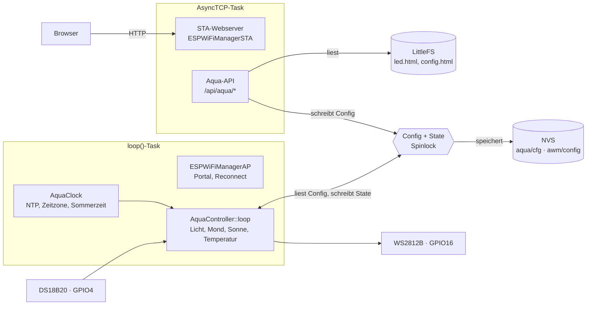

# ESP32 Aquarium-LED-Steuerung – Dokumentation

Stand: 14.10.2026

## Überblick

Die Firmware steuert einen WS2812B-LED-Strip mit bis zu 400 LEDs über einen ESP32 als Aquarium-Tageslicht mit Mondlicht und misst die Wassertemperatur. Die Lichtsteuerung läuft auch ohne WLAN weiter. Bedient wird das Gerät über Webseiten im Heimnetz (STA-Modus).

| Funktion | Kurzbeschreibung |
| --- | --- |
| WLAN-Manager | Captive-Portal zur Ersteinrichtung, automatischer Reconnect, mDNS, OTA-Updates |
| Uhr | NTP-Synchronisation, Zeitzone GMT-12 … GMT+13, EU-Sommerzeit, manuelle Zeiteinstellung |
| Sonne und Mond | Sonnenauf- und -untergang aus Breiten-/Längengrad, Mondalter 0–29 Tage |
| 4 Farbkanäle | Je Kanal Farbe EIN/AUS, Betriebsart UHR/EIN/AUS, zwei Schaltzeiträume |
| Dimmung | 3-stufiges Hoch- und Herunterdimmen an den Schaltzeiten |
| Mondbeleuchtung | Bis zu 3 LED-Bereiche, Helligkeit nach Mondphase |
| Temperatur | DS18B20, Anzeige jede Sekunde, 999.99 bei Sensorfehler |
| Wasserqualität | ADS1115 mit pH-Sensor (DFRobot Gravity) und TDS-Sensor (CQRobot), Kalibrierung im Browser (`/water`) |
| OLED-Anzeige | 1,5"-Display 128×128 (SH1107): Uhrzeit, WLAN, wechselnde Messwerte (Temperatur, pH, TDS), Kanäle, Mond |

## Hardware & Verdrahtung

Zielboard ist ein ESP32-WROOM-32-Devkit (gebaut wurde u. a. für *uPesy ESP32 WROOM DevKit* bzw. *ESP32-WROOM-DA*), 4 MB Flash. Alle Pins sind als `#define` im Sketch `ESP32_AquaControl.ino` (Zeilen 54–85) änderbar; sie können auch per Compiler-Flag (`-DLED_STRIP_PIN=…`) überschrieben werden, da jedes Define in `#ifndef` steht.

### Pinbelegung

| Funktion | GPIO | Define | Richtung | Pegel / Modus | Code |
| --- | --- | --- | --- | --- | --- |
| WS2812B-Datenleitung | **16** | `LED_STRIP_PIN` | Ausgang | 3,3 V, NeoPixel GRB 800 kHz | `AquaController.cpp` (`Adafruit_NeoPixel`) |
| DS18B20 (1-Wire) | **4** | `ONEWIRE_PIN` | bidirektional, Open-Drain | externer Pull-up 4,7 kΩ → 3,3 V | `AquaController.cpp` (`OneWire`, `DallasTemperature`) |
| I2C SDA (ADS1115 + OLED) | **8** | `I2C_SDA_PIN` | bidirektional | 3,3 V, 400 kHz, Pull-ups meist auf den Modulen | `AquaWater.cpp`, `AquaDisplay.cpp` (`Wire`) |
| I2C SCL (ADS1115 + OLED) | **9** | `I2C_SCL_PIN` | Ausgang | 3,3 V | `AquaWater.cpp`, `AquaDisplay.cpp` (`Wire`) |
| Status-LED | **2** | `LED_PIN` | Ausgang | HIGH-aktiv (HIGH = LED an), Start LOW | `ESPWiFiManagerAP.cpp` (`pinMode(ledPin, OUTPUT)`) |
| Taster (Provisionierung) | **0** | `BTN_PIN` | Eingang | `INPUT_PULLUP`, LOW = gedrückt | `ESPWiFiManagerAP.cpp`, `loop()` im Sketch |
| Serielle Konsole TX | 1 | – | Ausgang | UART0, 115200 Baud | `Serial.begin(115200)` |
| Serielle Konsole RX | 3 | – | Eingang | UART0 | Flashen per USB |
| SPI-Flash | 6–11 | – | – | intern belegt | **nicht verwenden** |

Bei `BTN_PIN = -1` entfällt nur die Laufzeit-Abfrage im Sketch; der AP-Manager wertet beim Boot weiterhin GPIO0 aus.

### Anschlussplan

```
                  ESP32-DevKit                         5-V-Netzteil (≥ Strip-Bedarf)
               ┌───────────────┐                        +5V            GND
   USB ────────┤ 5V/VIN        │                         │              │
               │               │                         │   ┌─────────┐│
               │        GPIO16 ├──[330 Ω]──►(Pegelwandler optional)──►DIN│  WS2812B-Strip
               │               │                         ├───┤ +5V     ││  LED 1 … n
               │           GND ├─────────────────────────┼───┤ GND     ├┘
               │               │                    [1000 µF / 10 V]
               │               │                         │              │
               │          3V3  ├────┬─────────────── VDD (rot)  ─┐
               │               │  [4,7 kΩ]                       │ DS18B20
               │         GPIO4 ├────┴─────────────── DQ  (gelb) ─┤ wasserdicht
               │           GND ├──────────────────── GND (schwarz)┘
               │               │
               │               │         I2C-Bus (parallel an beide Module)
               │          3V3  ├──────────┬─────────────┬── VCC ┐
               │         GPIO8 ├──────────┼───────┬─────┼── SDA ┤ ADS1115 (0x48)
               │         GPIO9 ├──────────┼───┬───┼─────┼── SCL ┤ pH / TDS
               │           GND ├────┬─────┼───┼───┼─────┼── GND ┘
               │               │    │     │   │   │     │
               │               │    │     └───┼───┼─────┼── VCC ┐
               │               │    │         │   └─────┼── SDA ┤ OLED 128×64 (0x3C)
               │               │    │         └─────────┼── SCL ┤ 128×128 SH1107
               │               │    └───────────────────┴── GND ┘
               │               │   (Pull-ups 4,7 kΩ → 3V3 sitzen meist schon auf den Modulen)
               │               │
               │         GPIO2 ├──[330 Ω]──►|── GND    Status-LED (auf vielen DevKits bereits verbaut)
               │         GPIO0 ├──┤ Taster ├── GND     BOOT-Taste (auf dem DevKit vorhanden)
               └───────────────┘
```

Kabelfarben des DS18B20 können je nach Hersteller abweichen (teils Rot/Gelb/Grün oder Rot/Weiß/Schwarz) – Datenblatt bzw. Aufdruck prüfen.

### Hinweise zu den Pins

- **GPIO0 und GPIO2 sind Strapping-Pins.** GPIO0 LOW beim Reset startet den Download-Modus – den Taster also nicht beim Einschalten gedrückt halten, außer zum Flashen. Wer den Taster mit Strapping-Funktion nicht beim Booten auswerten möchte, legt ihn auf einen freien Pin (z. B. GPIO32) und setzt `BTN_PIN` entsprechend; der AP-Manager nutzt dann diesen Pin. GPIO2 muss beim Flashen LOW oder offen sein; eine LED nach GND stört nicht.
- **GPIO16** ist auf WROVER-Modulen (mit PSRAM) intern belegt. Bei einem WROVER-Board den Strip auf einen anderen Ausgang legen, z. B. GPIO13, GPIO25 oder GPIO27.
- **GPIO34–39** sind nur Eingänge ohne internen Pull-up – nicht für Strip oder 1-Wire geeignet.
- **ADC2-Pins** (u. a. GPIO0, 2, 4, 12–15, 25–27) sind analog nicht nutzbar, solange WLAN aktiv ist; digital (wie hier) ist das unerheblich.
- **GPIO12** ist ein Strapping-Pin für die Flash-Spannung; nichts mit Pull-up daran anschließen.

Freie, unkritische Pins für Erweiterungen: GPIO13, 14, 15, 17, 18, 21, 40, 41, 42 (GPIO8/9 belegt der ADS1115). Auf dem ESP32-S3 nicht verwenden: GPIO19/20 (USB), 26–32 (Flash), 33–37 (PSRAM bei Octal-Modulen), 43/44 (UART0); GPIO3, 45, 46 sind Strapping-Pins.

### Stromversorgung

| Verbraucher | Typischer Strom | Bemerkung |
| --- | --- | --- |
| ESP32 mit WLAN | 80–250 mA (Spitzen ~500 mA) | über USB oder 5 V an VIN |
| WS2812B je LED | bis ~60 mA (Weiß, 100 %) | ~1 mA im Ruhezustand (Schwarz) |
| 60 LEDs (Standard) | bis ~3,6 A | |
| 400 LEDs (Maximum) | bis ~24 A | |
| DS18B20 | ~1,5 mA beim Messen | |

- Den Strip aus einem eigenen 5-V-Netzteil versorgen und **die Masse mit dem ESP32 verbinden** – ohne gemeinsame Masse kommen keine Daten an.
- Netzteil mit ~20 % Reserve auf den Maximalstrom auslegen. Die Firmware hat keine globale Strombegrenzung; die Dimmstufen und Farben bestimmen den tatsächlichen Strom. Mit den Standardfarben (Kanal 1 weiß, übrige farbig) liegt der Bedarf deutlich unter dem Weiß-Maximum.
- Ab etwa 100 LEDs bzw. 1,5 m Länge die 5 V zusätzlich am Ende (und ggf. in der Mitte) einspeisen, sonst verfärben sich die hinteren LEDs ins Rötliche.
- Elko 1000 µF / ≥ 6,3 V direkt am Strip-Eingang zwischen +5 V und GND, Widerstand 330 Ω in Serie in der Datenleitung nahe am ESP32.
- Leitungsquerschnitt für die 5-V-Zuleitung: bis 5 A ≥ 0,75 mm², bis 10 A ≥ 1,5 mm². Eine passende Feinsicherung in die +5-V-Leitung setzen.
- Den ESP32 entweder per USB **oder** aus dem 5-V-Netzteil an VIN versorgen, nicht beides gleichzeitig ohne Schutzdiode.

### Signalpegel

Der ESP32 gibt 3,3 V aus; WS2812B bei 5 V Versorgung erkennen HIGH erst ab ~0,7 × VDD = 3,5 V. Bei kurzer Leitung (< 50 cm) funktioniert es meist trotzdem. Bei Flackern, Fehlfarben oder langer Leitung einen Pegelwandler einsetzen, z. B. 74AHCT125 oder 74HCT245 (mit 5 V versorgt). Alternativ die erste LED über eine Diode (1N4148) mit ~4,3 V versorgen.

### Temperatursensor

- Wasserdichter DS18B20 mit Edelstahlhülse, 3-Draht-Betrieb (kein parasitäres Netzteil).
- Pull-up 4,7 kΩ zwischen DQ und 3,3 V; bei Kabeln > 5 m auf 2,2 kΩ verringern.
- Es wird nur der erste gefundene Sensor auf dem Bus ausgewertet (Index 0), Auflösung 12 Bit (0,0625 °C).
- Der Sensor kann im Betrieb angesteckt werden; der Bus wird bei Fehler alle 30 s neu durchsucht.

### Wasserqualität (ADS1115, pH, TDS)

Beide Analogsensoren hängen am ADS1115 (16 Bit, I2C-Adresse `0x48`, `ADDR` an GND), weil der ADC des ESP32 zu ungenau und bei aktivem WLAN teilweise unbrauchbar ist.

```
   ESP32                ADS1115-Modul              Sensoren
   3V3  ───────────────  VDD
   GND  ───────────────  GND ───────────────────── GND beider Sensoren
   GPIO8  (SDA) ───────  SDA
   GPIO9  (SCL) ───────  SCL
                         ADDR ── GND   (Adresse 0x48)
                         A0  ◄───────────────────── pH-Platine, Signal (Po, 0–3 V)
                         A1  ◄───────────────────── TDS-Sensor, Signal (OUT, 0–2,3 V)
```

| Kanal | Sensor | Ausgang | Auswertung |
| --- | --- | --- | --- |
| AIN0 | DFRobot Gravity Analog-pH | 0–3 V | 2-Punkt-Kalibrierung pH 7 / pH 4, Temperaturkompensation optional |
| AIN1 | CQRobot TDS | 0–2,3 V | Polynom des Herstellers, Temperaturkompensation optional, Faktor 0,5 (ppm); Leitwert = 2 × TDS |

- ADS1115 mit **3,3 V** versorgen (Eingänge dürfen VDD + 0,3 V nicht überschreiten); Messbereich ±4,096 V, Auflösung 0,125 mV.
- Die Sensorplatinen (DFRobot Gravity pH V2: 3,3–5,5 V, CQRobot TDS: 3,3–5,5 V) laufen beide mit **3,3 V**; **Massen aller Teile verbinden.** Wird die pH-Platine mit 5 V betrieben und liefert mehr als 3,3 V am Ausgang, einen Spannungsteiler vor den Eingang setzen und die Kalibrierung durchführen.
- Ohne ADS1115 oder Sensorsignal (< 50 mV) zeigt die Seite „kein Sensorsignal“; der ADS1115 wird dann alle 30 s neu gesucht.
- Temperaturkompensation ist für pH und TDS/Leitwert getrennt zuschaltbar (Standard: aus, siehe unten). Ohne Kompensation sollten Kalibrierung und Messung bei ähnlicher Wassertemperatur erfolgen.
- pH- und TDS-Sensor beeinflussen sich im selben Wasser durch Streuströme: möglichst nicht gleichzeitig dauerhaft eintauchen oder den TDS-Sensor getrennt versorgen / potentialfrei (galvanisch getrennte pH-Platine) betreiben.

**Kalibrierung** (Seite `/water`): zuerst Sensor in Pufferlösung pH 7 → „Puffer pH 7 übernehmen“, dann pH 4 → „Puffer pH 4 übernehmen“. Für TDS Referenzlösung (z. B. 1000 ppm) eintragen und „Übernehmen“. Die Werte bleiben im NVS (`aqua/phv7`, `phv4`, `tdsk`). Werkseinstellung: 1500 mV / 2032 mV (DFRobot-Standard), Faktor 1,0.

**Manuell einstellen** (Abschnitt „pH manuell einstellen“ auf `/water`): Die Kalibrierspannungen für pH 7 und pH 4 lassen sich direkt in mV eintragen (0–3300 mV, mindestens 100 mV Abstand). Zusätzlich gibt es einen festen **pH-Offset** (±3), der zum berechneten pH-Wert addiert wird, z. B. `+0,50`, wenn das Gerät 0,5 zu niedrig anzeigt. Der Offset bleibt bei einer neuen Puffer-Kalibrierung erhalten und wird nur durch „Kalibrierung zurücksetzen“ auf 0 gestellt (NVS `aqua/phoff`; API `{"phV7":1500,"phV4":2032}` und `{"phOff":0.5}`).

**Sensor-Schalter:** Auf `/water` lassen sich pH- und TDS-Sensor einzeln als „angeschlossen“ markieren (Standard: beide an). Ein abgeschalteter Kanal wird nicht gemessen und als „nicht angeschlossen“ angezeigt; ein offener ADS1115-Eingang würde sonst Zufallswerte liefern. Die Schalter bleiben auch nach „Kalibrierung zurücksetzen“ erhalten (NVS `aqua/phen`, `tdsen`; API `{"phEn":false,"tdsEn":true}`).

**Temperaturkompensation** (Abschnitt „Temperaturkompensation“ auf `/water` bzw. in der App, Standard: beide aus): nutzt die Wassertemperatur des DS18B20. Ist keine gültige Temperatur vorhanden (Sensor fehlt/Fehler, außerhalb −10…60 °C), wird nicht kompensiert.

- **pH:** Die Elektrodensteilheit ist proportional zur absoluten Temperatur (Nernst, ≈ 59,16 mV/pH bei 25 °C), Drehpunkt pH 7. Die kalibrierte Steigung wird mit `(T + 273,15) / (T_kal + 273,15)` skaliert. `T_kal` ist die Wassertemperatur bei „Puffer pH 7/4 übernehmen“ (maßgeblich: der zuletzt übernommene Punkt); bei manuell eingegebenen Spannungen und nach „Kalibrierung zurücksetzen“ gilt 25 °C. Kompensiert wird nur die Elektrode, nicht die tatsächliche pH-Änderung des Wassers mit der Temperatur.
- **TDS / Leitwert:** Sensorspannung wird auf 25 °C umgerechnet: `V25 = V / (1 + 0,02 · (T − 25))` (Hersteller-Beispiel). Die TDS-Kalibrierung verwendet dabei den kompensierten Messwert – nach dem Ein-/Ausschalten daher neu kalibrieren.
- NVS `aqua/phtc`, `tdstc`, `phcalt`; API `{"phTc":true,"tdsTc":true}`. `GET /api/aqua/water` liefert zusätzlich `phTc`, `tdsTc`, `tcOk` (Temperatur gültig) und `cal.phT`.

### OLED-Anzeige (1,5", 128×128, SH1107)

OLED 128×128, Controller **SH1107**, per **I2C** am selben Bus wie der ADS1115 (SDA = GPIO8, SCL = GPIO9, Adresse `0x3C`, `OLED_ADDR`). Bibliothek: **U8g2** (Treiber `U8G2_SH1107_128X128_F_HW_I2C`). Zeigt das Bild verschoben oder fehlerhaft, in `src/AquaDisplay.h` auf `U8G2_SH1107_SEEED_128X128_F_HW_I2C` oder `U8G2_SH1107_PIMORONI_128X128_F_HW_I2C` wechseln; Graustufen-Module (SSD1327) brauchen `U8G2_SSD1327_WS_128X128_F_HW_I2C`. Layout: Kopfzeile (Uhrzeit, WLAN), wechselnder Messwert groß, Fußzeile mit Kanalhelligkeiten in % (links) und „Mond“ (rechts).

| Modulpin | Anschluss |
| --- | --- |
| GND | GND |
| VCC | 3,3 V |
| SDA | GPIO8 |
| SCL | GPIO9 |

- Die I2C-Adresse (`0x3C`/`0x3D`) wählt der Adress-Lötpunkt bzw. die Widerstandsbrücke auf dem Modul; abweichende Adressen über `OLED_ADDR` einstellen.
- Aufbau (1× pro Sekunde aktualisiert):
  - **Kopfzeile:** Uhrzeit links (`--:--` ohne gültige Zeit), „WLAN“ bzw. „kein WLAN“ rechts, darunter eine Trennlinie.
  - **Mitte:** Es wird jeweils **ein** Messwert groß und horizontal zentriert angezeigt, mit Beschriftung darüber. Alle 3 s wechselt die Anzeige reihum zwischen Temperatur (°C), pH und TDS (ppm). `--` steht bei Sensorfehler oder fehlendem Wert.
  - **Fußzeile:** Kanalhelligkeit K1–K4 in % (links) und „Mond“, wenn der Mond leuchtet (rechts).
- Der Kontrast steht auf Maximum (255, `kContrast` in `AquaDisplay.cpp`); für längere Lebensdauer des OLED niedriger einstellen. Fehlt das Display, wird alle 30 s neu gesucht; beim ersten Fehlschlag listet die serielle Konsole alle I2C-Geräte (I2C-Scan).

### Stückliste

| Anz. | Bauteil | Hinweis |
| --- | --- | --- |
| 1 | ESP32-WROOM-32 DevKit (4 MB Flash) | mit BOOT-Taste und LED an GPIO2 |
| 1 | WS2812B-Strip, 5 V, 1–400 LEDs | Farbreihenfolge GRB |
| 1 | 5-V-Netzteil | Strom nach Tabelle oben |
| 1 | DS18B20, wasserdicht | 3-Draht |
| 1 | OLED 1,5", 128×128, SH1107 | I2C, Adresse 0x3C |
| 1 | ADS1115-Breakout (16 Bit, I2C) | Wasserqualität |
| 1 | DFRobot Gravity Analog-pH-Sensor | an AIN0 |
| 1 | CQRobot TDS-Sensor (Ausgang 0–2,3 V) | an AIN1 |
| 1 | Widerstand 4,7 kΩ | 1-Wire-Pull-up |
| 1 | Widerstand 330 Ω | Serienwiderstand Datenleitung |
| 1 | Elko 1000 µF, ≥ 6,3 V | Pufferung am Strip |
| 0–1 | 74AHCT125 o. ä. | Pegelwandler (optional) |
| 1 | Feinsicherung + Halter | in +5 V |
| – | Schraubklemmen / Stecker, Kabel | Querschnitt nach Strom |

### LED-Zuordnung am Strip

Die LEDs werden ab dem Einspeisepunkt (DIN) gezählt, beginnend mit 1. Die Kanäle wiederholen sich reihum:

| LED | 1 | 2 | 3 | 4 | 5 | 6 | 7 | 8 | 9 | … |
| --- | --- | --- | --- | --- | --- | --- | --- | --- | --- | --- |
| Kanal | 1 | 2 | 3 | 4 | 1 | 2 | 3 | 4 | 1 | … |

Werkseinstellung der Kanäle: 1 = Weiß `#ffffff`, 2 = Blau `#3060ff`, 3 = Warmweiß `#ffb070`, 4 = Rot `#ff4020`. Mond-LEDs werden über ihre Nummern (`von-bis`) adressiert und überschreiben die Kanalfarbe, wenn der Mond leuchtet. LEDs oberhalb von „Anzahl LEDs“ bleiben dunkel.

### Flash-Aufteilung (`partitions.csv`)

| Name | Typ | Offset | Größe | Inhalt |
| --- | --- | --- | --- | --- |
| nvs | data/nvs | 0x9000 | 20 KB | WLAN-Config (`awm`), Aqua-Config (`aqua/cfg`) |
| otadata | data/ota | 0xE000 | 8 KB | aktiver OTA-Slot |
| app0 | app/ota_0 | 0x10000 | 1,75 MB | Firmware Slot A |
| app1 | app/ota_1 | 0x1D0000 | 1,75 MB | Firmware Slot B |
| coredump | data/coredump | 0x390000 | 64 KB | Absturzabbild |
| littlefs | data/littlefs | 0x3A0000 | 384 KB | Webseiten aus `data/` |

## Build & Flashen

Gebaut wird mit Visual Studio + vMicro (oder `arduino-cli`) gegen den ESP32-Core 3.3.12. ElegantOTA muss auf den Async-Webserver umgestellt sein; das erledigt `build_opt.h` im Sketch-Ordner (`-DELEGANTOTA_USE_ASYNC_WEBSERVER=1`, wird vom ESP32-Core für alle Quelldateien inkl. Bibliotheken übernommen). Die Bibliothek selbst muss dafür nicht mehr angepasst werden.

| Bibliothek | Version | Zweck |
| --- | --- | --- |
| U8g2 | 2.36.19 | OLED SH1107 |
| ESP Async WebServer + Async TCP | 3.10.3 | Webserver für Portal und STA |
| ElegantOTA | Async-Modus | Firmware-Update unter `/update` |
| ArduinoJson | 7.x | Konfiguration und API |
| Adafruit NeoPixel | 1.15.4 | WS2812B-Ausgabe |
| OneWire / DallasTemperature | 2.3.8 / 4.0.6 | DS18B20 |
| sunMoon + Time (TimeLib) | – / 1.6.1 | Sonnenzeiten und Mondalter |

1. Partitionsschema `partitions.csv` verwenden: 2 App-Slots zu je 0x1C0000, LittleFS 0x60000 ab 0x3A0000. Mit dem Standardschema ist der Programmspeicher zu 93 % belegt, mit dem eigenen zu etwa 66 %.
2. Neue `.cpp`-Dateien unter `src\` müssen in `ESP32_AquaControl.vcxproj` eingetragen sein, sonst kompiliert vMicro sie nicht.
3. Firmware per USB flashen oder per OTA: `.\App-OTA.ps1 -Ip <ESP-IP>` bzw. im Browser unter `http://<ESP-IP>/update`.
4. Web-Dateien aus `data\` als LittleFS-Image hochladen: seriell `.\LittleFS.ps1 -Flash -Port COM4` oder per WLAN `.\LittleFS-OTA.ps1 -Ip <ESP-IP>`. Nach Änderungen an HTML/CSS ist dieser Schritt immer nötig.

Einstellungen liegen im NVS und überleben Firmware- und LittleFS-Updates.

## Inbetriebnahme & WLAN

Ohne gespeicherte Zugangsdaten öffnet das Gerät ein Captive-Portal: WLAN `WiFi Manager` (Passwort `123456789`), Seite `http://192.168.4.1`. Dort Netz wählen, Passwort eingeben und speichern; das Gerät startet neu und verbindet sich mit dem Heimnetz.

1. Nach dem Einschalten blinkt die Status-LED 2 s langsam. Wird der Taster in dieser Zeit gedrückt, zählt die Haltedauer.
2. Taster 2–5 s halten → Portal öffnet sich. Taster ≥ 5 s halten → Zugangsdaten werden gelöscht, Neustart.
3. Ohne Tastendruck verbindet sich das Gerät mit dem gespeicherten WLAN (Timeout 15 s), synchronisiert die Uhr und startet mDNS (`<hostname>.local`). Schlägt das fehl, öffnet sich das Portal.
4. Im Betrieb öffnet ein Tastendruck ≥ 0,7 s das Portal zur Neukonfiguration.
5. Bei Verbindungsverlust versucht das Gerät alle 10 s einen Reconnect. Nach 60 s ohne Verbindung öffnet sich das Portal.
6. Mit gespeicherten Zugangsdaten schließt sich das Portal nach 300 s ohne Zugriff und der Reconnect läuft weiter.

Im Heimnetz ist die Startseite unter `http://<ESP-IP>/` oder `http://<hostname>.local/` erreichbar. Sie verlinkt auf LED-Steuerung, Konfiguration und WLAN-Einstellungen.

| Status-LED | Bedeutung |
| --- | --- |
| Dauerhaft an | Mit WLAN verbunden |
| Langsam blinkend (1 Hz) | Portal aktiv bzw. Boot-Wartezeit |
| Schnell blinkend (5 Hz) | WLAN-Scan läuft / Taster beim Boot < 2 s gehalten |
| Doppelblitz | Taster beim Boot 2–5 s gehalten |
| Dreifachblitz | Taster ≥ 5 s: Zugangsdaten werden gelöscht |
| Aus | Nicht verbunden, kein Portal |

## Bedienung: LED-Steuerung (`/led`)

Oben zeigt die Seite den Live-Status, darunter alle Lichteinstellungen; „Speichern“ übernimmt sie sofort und dauerhaft.

**Status** (Aktualisierung jede Sekunde)

- Uhrzeit mit Sommer-/Normalzeit, Datum und NTP-Status in der Kopfzeile
- Wassertemperatur in °C, rot `999.99` bei Sensorfehler
- Sonnenaufgang – Sonnenuntergang (Lokalzeit)
- Mondalter in Tagen und Mondhelligkeit (/256)
- Je Kanal ein Farbfeld mit aktueller Farbe und Helligkeit in %, dazu der Mond an/aus

**Einstellungen**

| Feld | Werte | Wirkung |
| --- | --- | --- |
| Anzahl LEDs | 1–400 | LEDs darüber hinaus bleiben dunkel |
| Dauer je Stufe | 0–120 min | 0 = hart schalten ohne Dimmung |
| Stufen 1–3 | je 1–100 % | Helligkeit der drei Dimmstufen, Standard 33 / 66 / 100 % |
| Kanal: Betriebsart | UHR / EIN / AUS | UHR = nach Schaltzeiten, EIN/AUS = Handbetrieb |
| Kanal: Farbe EIN / AUS | Farbwähler | Tag- bzw. Nachtfarbe des Kanals |
| Kanal: Zeitraum 1 und 2 | HH:MM bis HH:MM | Kanal an, solange die Zeit in einem Zeitraum liegt; gleiche Zeiten = deaktiviert |
| Mond: Betriebsart | AUTO / EIN / AUS | siehe Funktionsweise |
| Mond: Farbe | Farbwähler | Grundfarbe, wird nach Mondphase gedimmt |
| Mond: LEDs | `von-bis;einzeln;von-bis` | max. 5 Einträge, z. B. `37-48;67-78;107-118` |

Fehlerhafte Eingaben werden nicht gespeichert; die Seite zeigt den Grund (z. B. „Mond-Bereich außerhalb 1–400“).

## Bedienung: Wasserqualität (`/water`)

Die Seite zeigt jede Sekunde pH-Wert, TDS (ppm), Leitwert (µS/cm) und die Wassertemperatur, darunter die Kalibrierung (siehe Abschnitt Wasserqualität unter Hardware). Ein pH-Wert außerhalb 0–14 wird rot dargestellt. „Kalibrierung zurücksetzen“ stellt die Werkswerte wieder her. Zu dicht beieinanderliegende Kalibrierpunkte (< 100 mV) und unplausible TDS-Faktoren (außerhalb 0,2–5) werden abgelehnt.

## Bedienung: Konfiguration (`/config`)

Hier werden Uhr und Standort eingestellt; die Kopfzeile zeigt die aktuelle Gerätezeit.

| Feld | Werte | Hinweis |
| --- | --- | --- |
| NTP-Status | nie gesetzt / Synchronisierung fehlgeschlagen / synchronisiert | mit Zeitpunkt der letzten Synchronisierung |
| NTP-Server | Hostname, max. 63 Zeichen | leer = `de.pool.ntp.org`; gleiches Feld wie „NTP 1“ in den WLAN-Einstellungen |
| Zeitzone | GMT-12 … GMT+13 | Standardzeit, Deutschland = GMT+1 |
| Sommer-/Winterzeit | an / aus | EU-Regel, +1 h |
| Breitengrad | -90 … 90 | Dezimalgrad, Nord positiv |
| Längengrad | -180 … 180 | Dezimalgrad, Ost positiv |

**Manuelle Zeiteinstellung:** Datum und Uhrzeit (Lokalzeit) eingeben oder „Zeit dieses Geräts übernehmen“ wählen, dann „Uhrzeit setzen“. Bei aktiver NTP-Verbindung überschreibt die nächste Synchronisierung die manuelle Zeit.

Nach Änderung des NTP-Servers wird sofort neu synchronisiert. Antwortet der Server nicht innerhalb von 30 s, zeigt der Status „Synchronisierung fehlgeschlagen“.

## Funktionsweise im Detail

### Kanäle und Schaltzeiten

Die LEDs werden reihum auf 4 Kanäle verteilt: LED n gehört zu Kanal ((n − 1) mod 4) + 1, also Kanal 1 = LED 1, 5, 9, … Im Modus UHR ist ein Kanal an, solange die Uhrzeit in Zeitraum 1 oder 2 liegt. Ein Zeitraum mit EIN > AUS läuft über Mitternacht (z. B. 22:00–02:00). Ohne gültige Uhrzeit bleiben UHR-Kanäle aus.

### Dimm-Rampe (Sonnenauf- und -untergang)

In den ersten Minuten eines Zeitraums läuft der Kanal durch die Stufen 1 → 2 → 3, in den letzten Minuten rückwärts. Die Farbe wird dabei linear zwischen AUS-Farbe (0 %) und EIN-Farbe (100 %) gemischt. Ist ein Zeitraum kürzer als 4 Stufen, gilt jeweils die niedrigere der beiden Stufen. Liegen beide Zeiträume gleichzeitig an, gilt die höhere Helligkeit.

Beispiel: Zeitraum 10:00–13:00, 10 min je Stufe, Standardstufen 33 / 66 / 100 %:

| Uhrzeit | Helligkeit |
| --- | --- |
| vor 10:00 | aus (AUS-Farbe) |
| 10:00–10:10 | 33 % |
| 10:10–10:20 | 66 % |
| 10:20–12:40 | 100 % |
| 12:40–12:50 | 66 % |
| 12:50–13:00 | 33 % |
| ab 13:00 | aus (AUS-Farbe) |

Mit 0 min je Stufe schaltet der Kanal hart ein und aus.

### Mondbeleuchtung

| Mond-Modus | Kanäle | Mond-LEDs |
| --- | --- | --- |
| AUTO | laufen normal (UHR/EIN/AUS) | an, sobald kein Kanal eingeschaltet ist; Helligkeit nach Mondphase |
| EIN | alle dunkel | an mit fester Vollmond-Helligkeit 30/256 |
| AUS | alle dunkel | aus (Strip komplett dunkel) |

Im Modus AUTO ist die Helligkeit 2 × Tage bis bzw. seit Neumond, also 0/256 bei Neumond bis 30/256 bei Vollmond (Mondalter 15). Leuchtet der Mond, überschreibt er die Kanalfarbe der Mond-LEDs; die übrigen LEDs zeigen ihre AUS-Farbe.

### Uhr und Sommerzeit

Die Systemzeit läuft in UTC und wird per SNTP (UDP-Port 123) gestellt. Lokalzeit = UTC + Zeitzone + 1 h, wenn Sommerzeit aktiv ist. Die EU-Regel gilt vom letzten Sonntag im März 01:00 UTC bis zum letzten Sonntag im Oktober 01:00 UTC.

### Sonne, Mond und Temperatur

Sonnenauf- und -untergang sowie das Mondalter berechnet die Bibliothek *sunMoon* einmal pro Minute aus Datum, Zeitzone und Standort. Der DS18B20 misst mit 12 Bit alle 0,8 s ohne Blockieren. Liefert er −127 °C (getrennt) oder 85 °C (Einschaltwert), wird `999.99` angezeigt, und alle 30 s wird der Bus neu durchsucht.

## HTTP-API

Alle Endpunkte laufen auf dem STA-Server (Port 80) und liefern bzw. erwarten JSON.

| Methode | Pfad | Zweck |
| --- | --- | --- |
| GET | `/api/aqua/status` | Live-Werte: Zeit, NTP, Sonne, Mond, Temperatur, Kanalzustände |
| GET | `/api/aqua/settings` | Komplette Konfiguration inkl. NTP-Server und Gerätezeit |
| POST | `/api/aqua/settings` | Teil-Update, `Content-Type: application/json` |
| GET | `/api/aqua/water` | Wasserqualität: pH, TDS, Leitwert, Rohspannungen, Kalibrierung (`null` = nicht verfügbar) |
| POST | `/api/aqua/water/cal` | Kalibrieren: `{"ph7":true}`, `{"ph4":true}`, `{"phV7":1500,"phV4":2032}`, `{"phOff":0.5}`, `{"tds":1000}`, `{"reset":true}`, Schalter `{"phEn":…,"tdsEn":…}` / `{"phTc":…,"tdsTc":…}` |
| GET | `/dashboard`, `/led`, `/water`, `/config` | Web-Seiten (`/dashboard`: Status und Messwerte mit 5-min-Verlauf, nutzt `/api/aqua/status` und `/api/aqua/water`) |
| GET/POST | `/api/sta/config` | Netzwerk (DHCP/statisch, Hostname, NTP 1/2) |
| POST | `/erase` | Zugangsdaten löschen und Neustart |
| GET/POST | `/update` | ElegantOTA |

**Antwort `GET /api/aqua/status`**

```json
{"valid":true,"date":"30.09.2026","time":"14:05:12","dstActive":true,
 "ntp":2,"ntpText":"synchronisiert","lastSync":"30.09.2026 13:58",
 "sunrise":"07:08","sunset":"18:52","moonAge":8,"moonBright":16,"moonLit":false,
 "temp":24.56,
 "ch":[{"on":true,"level":100,"color":"#ffffff"}, … 4 Einträge]}
```

`ntp`: 0 = nie gesetzt, 1 = fehlgeschlagen, 2 = synchronisiert.

**Body `POST /api/aqua/settings`** – jeder Block ist optional:

```json
{"leds":120,
 "ramp":{"step":10,"lv":[33,66,100]},
 "ch":[{"mode":0,"on":"#ffffff","off":"#000000",
        "p":[{"on":"10:00","off":"13:00"},{"on":"15:00","off":"21:00"}]}, … genau 4],
 "moon":{"mode":0,"color":"#6080ff","ranges":"37-48;67-78"},
 "tz":1,"dst":true,"lat":52.52,"lon":13.40,
 "ntp":"de.pool.ntp.org",
 "setTime":"2026-09-30T14:05:00"}
```

`mode` bei Kanälen: 0 = UHR, 1 = EIN, 2 = AUS; beim Mond: 0 = AUTO, 1 = EIN, 2 = AUS. Erfolg: `{"ok":true}`; Fehler: HTTP 400/500 mit `{"ok":false,"error":"…"}`, dann wird nichts übernommen.

## Software-Architektur

Webanfragen laufen im AsyncTCP-Task, Licht und Sensoren im `loop()`-Task; beide greifen nur unter einem Spinlock auf Konfiguration und Laufzeitstatus zu.



Die Konfiguration ist eine reine Datenstruktur ohne `String`-Felder und lässt sich deshalb im kritischen Abschnitt kopieren.

| Datei | Aufgabe |
| --- | --- |
| `ESP32_AquaControl.ino` | Start, Taster, Reconnect-Logik, Aufruf aller Module |
| `src/ESPWiFiManagerAP.*` | Captive-Portal, DNS, WLAN-Scan, Reconnect, Status-LED |
| `src/ESPWiFiManagerSTA.*` | Webserver im Heimnetz, `setExtraRoutes()` für die Aqua-Seiten |
| `src/ESPWiFiManagerCommon.*` | NVS-Config, NTP, OTA, Datei-Auslieferung |
| `src/AquaConfig.*` | Datenmodell, JSON-Prüfung, NVS-Namespace `aqua` |
| `src/AquaClock.*` | Lokalzeit, EU-Sommerzeit, NTP-Status, manuelle Zeit |
| `src/AquaController.*` | Dimm-Rampe, Mond, Sonne, DS18B20, Strip-Ausgabe, `/api/aqua/*` |
| `src/AquaDisplay.*` | OLED SH1107 (U8g2): Uhrzeit, WLAN, wechselnde Messwerte, Kanäle, Mond |
| `src/AquaWater.*` | ADS1115 (nicht-blockierend), pH/TDS-Berechnung, Kalibrierung, `/water`, `/api/aqua/water*` |

Der Strip wird nur neu beschrieben, wenn sich Farben oder Mondzustand ändern, spätestens alle 10 s. Die Lichtberechnung läuft alle 250 ms, Sonne und Mond einmal pro Minute.

## Fehlerbehebung

| Symptom | Ursache | Lösung |
| --- | --- | --- |
| Linker: `undefined reference to ElegantOTAClass::begin(AsyncWebServer*, …)` | ElegantOTA-Bibliothek ohne Async-Modus | `build_opt.h` im Sketch-Ordner muss `-DELEGANTOTA_USE_ASYNC_WEBSERVER=1` enthalten (gilt auch für Bibliotheken); alternativ in `ElegantOTA.h` auf 1 setzen |
| `fatal error: FS.h` / `NetworkInterface.h` / `SHA1Builder.h` / `WiFi.h`: No such file or directory beim Kompilieren von ElegantOTA, AsyncTCP oder ESPAsyncWebServer | Bibliothekserkennung (vMicro) nimmt Bibliotheken nur auf, wenn die `.ino` sie direkt einbindet – Includes unter `src/` und in anderen Bibliotheken werden nicht ausgewertet | Jede benutzte Bibliothek im Sketch einbinden (Block „Nur für die Bibliothekserkennung“). Wer in `src/` eine neue Bibliothek nutzt, muss sie dort ergänzen |
| Linker: `undefined reference to AsyncCallbackJsonWebHandler::AsyncCallbackJsonWebHandler(…)` | ESPAsyncWebServer wurde ohne ArduinoJson im Include-Pfad gebaut (`ASYNC_JSON_SUPPORT 0`, `AsyncJson.cpp` leer); vMicro verwendet das alte Objekt aus dem Cache weiter | `#include <ArduinoJson.h>` im Sketch (ist enthalten), dann Build-Cache leeren: vMicro → *Clean* oder Ordner `%LOCALAPPDATA%\Temp\VMBuilds\ESP32_AquaControl\<board>\Debug` löschen |
| `Adafruit_NeoPixel.h` / `OneWire.h` / `DallasTemperature.h` / `TimeLib.h` / `sunMoon.h` nicht gefunden | Bibliothek nicht installiert | Über den Bibliotheksverwalter installieren (siehe Tabelle unter *Build & Flashen*) |
| Linker: `ld returned 1 exit status` in vMicro, `Aqua*.o` fehlen im Build-Ordner | Neue `.cpp` nicht in `ESP32_AquaControl.vcxproj` eingetragen | Datei ins Projekt aufnehmen, Projekt neu laden |
| `expected unqualified-id before 'if'` im Debug-Build | vMicro-Haltepunkt auf der schließenden `}` von `setup()` | Haltepunkt entfernen oder eine Zeile höher setzen, oder Release bauen |
| Temperatur zeigt `999.99` | Kein DS18B20 gefunden, Pull-up fehlt oder Kabelbruch | Verdrahtung und 4,7 kΩ prüfen; der Bus wird alle 30 s neu durchsucht |
| Uhr zeigt `--:--:--`, Kanäle bleiben aus | Noch keine NTP-Zeit, keine manuelle Zeit | Unter `/config` NTP-Server prüfen oder Uhrzeit manuell setzen |
| NTP-Status „fehlgeschlagen“ | Server nicht erreichbar oder UDP 123 gesperrt | Anderen Server eintragen, z. B. `ptbtime1.ptb.de` oder die Router-IP |
| `/led` meldet „led.html nicht gefunden“ | LittleFS-Image veraltet | `LittleFS.ps1` bzw. `LittleFS-OTA.ps1` ausführen |
| Neue Seiten ohne Gestaltung | `WifiManager.css` ist 1 Tag im Browser zwischengespeichert | Seite mit Strg+F5 neu laden |
| Falsche Farben am Strip | Farbreihenfolge oder Signalpegel | Strip-Typ GRB prüfen, Pegelwandler einsetzen |
| Sonnenzeiten falsch | Standort oder Zeitzone falsch | Breiten-/Längengrad (Nord/Ost positiv) und GMT-Offset prüfen |

## Sicherheit & offene Punkte

Das Gerät ist für ein vertrauenswürdiges Heimnetz gedacht: Keine Seite und keine API verlangt eine Anmeldung.

- [ ] ElegantOTA mit Benutzer und Passwort schützen (`ElegantOTA.setAuth(…)`); derzeit kann jeder im Netz unter `/update` Firmware einspielen.
- [ ] ArduinoOTA-Passwort setzen (Aufruf `ensureArduinoOta(…, "")` im Sketch).
- [ ] Standard-Portalpasswort `123456789` ändern (`setAPCredentials(…)`).
- [ ] `/erase` und `POST /api/aqua/settings` sind ungeschützt, auch gegen Anfragen fremder Webseiten im Browser (CSRF).
- [ ] Ungenutzte Dateien entfernen: `data/settingsAP.html`, `data/settingsSTA.html` (ca. 28 KB) und die Template-Variante von `serveFileFromLittleFS` in `ESPWiFiManagerCommon.h`.
- [ ] Fallback `SMART_RETRIES` öffnet das Portal, ohne den STA-Server zu stoppen (beide Port 80); mit dem verwendeten `ON_FAIL` tritt das nicht auf.
- [ ] Stromaufnahme begrenzen: Es gibt keine globale Helligkeitsbegrenzung; das Netzteil muss den vollen Strip tragen.

